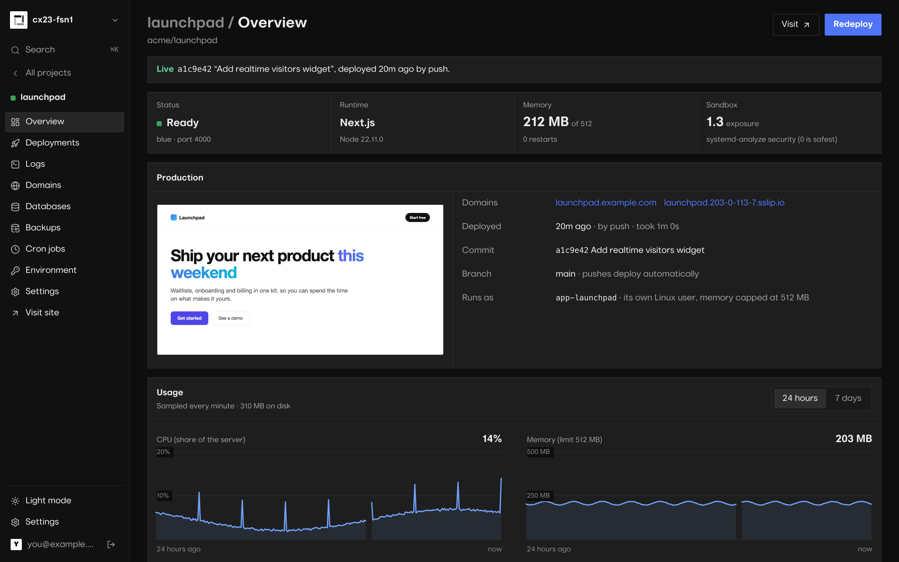
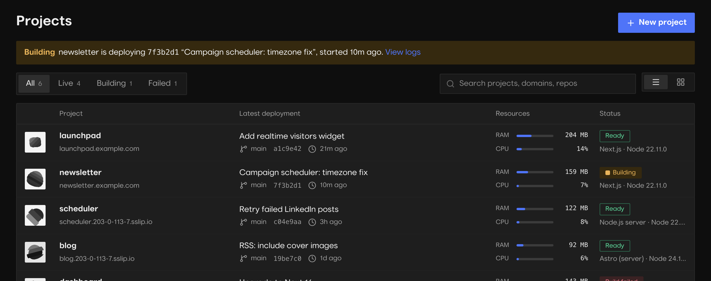
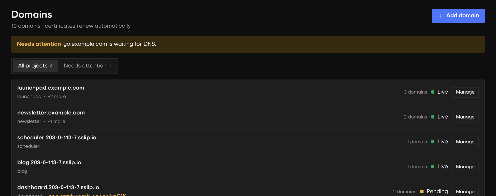
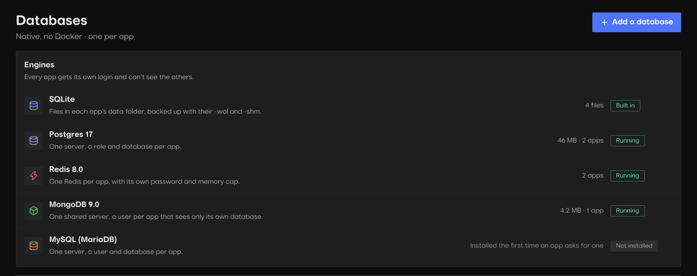
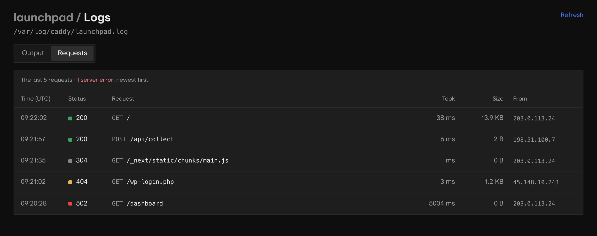
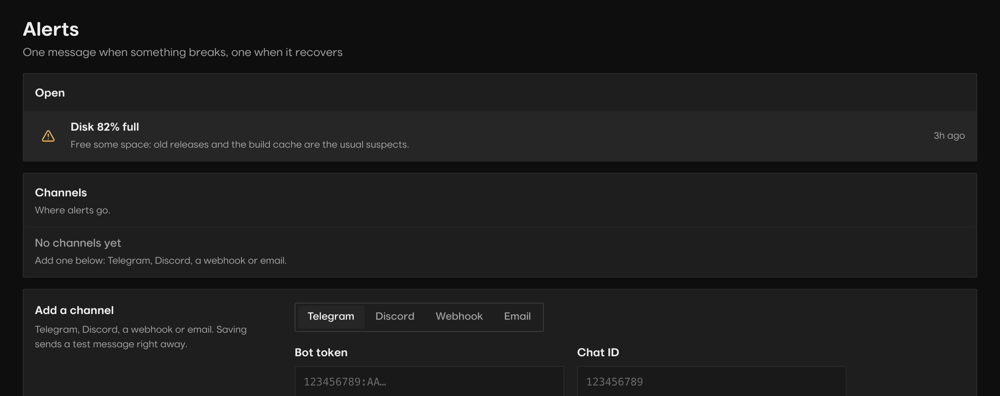

<div align="center">

<h1>Self Host Layer</h1>

<p><strong>The self-hosted Vercel, on a $5 server you own. No Docker.</strong></p>

<p>Push to GitHub and your app is live with HTTPS.<br/>Domains, databases, backups and alerts from a web panel that runs on your own server.</p>

<p>
<a href="https://selfhostlayer.com">Website</a> ·
<a href="https://selfhostlayer.com/docs">Docs</a> ·
<a href="#quick-start">Quick start</a> ·
<a href="CONTRIBUTING.md">Contributing</a>
</p>

<p>


</p>

</div>

```sh
curl -fsSL https://get.selfhostlayer.com | bash
```

<p align="center">
  
</p>

## Why

Vercel is lovely until the bill. Docker-based panels want a bigger server and hide your apps inside containers. Self Host Layer does what you'd do by hand (`git pull`, install, build, restart, a web server config, a certificate), done properly:

- **More apps per dollar.** No Docker. The panel idles at about 130 MB, so a 1 GB server runs many small apps.
- **Nothing hidden, no lock-in.** Every app is a plain folder, a Linux user, a systemd unit and a Caddy site you can read. Remove the panel and your apps keep running.
- **Safe by default.** Each app runs sandboxed as its own user with its own memory limit, so one app can't read or slow down another.

## Quick start

**You need** a fresh server with Ubuntu 24.04, Ubuntu 26.04 or Debian 12 (x86_64 or arm64), 1 GB RAM or more, 10 GB free disk, and ports 80 and 443 open. Any VPS works: Hetzner, DigitalOcean, Vultr, Linode…

**1. Install.** SSH in as root and run:

```sh
curl -fsSL https://get.selfhostlayer.com | bash
```

It takes a few minutes and ends with your panel's address and a one-time setup token:

```
┌──────────────────────────────────────────────────────────────┐
│  Self Host Layer is ready
│
│  Open:         https://203-0-113-7.sslip.io
│  Setup token:  ••••••••••••••••
│  (valid 24h, works once; re-run the installer for a new one)
└──────────────────────────────────────────────────────────────┘
```

**2. Create your account.** Open the address, paste the token, pick an email and password, and turn on two-factor sign-in. The address already has a real Let's Encrypt certificate.

**3. Connect GitHub.** Click **New project → Connect GitHub**. The panel creates a GitHub App that only you own, and you choose which repositories it can see.

**4. Import a repo.** Pick a repository. The framework, package manager, build and start commands are detected for you; change anything you like, add environment variables, then **Deploy**. A minute later it's live at `https://<app>.<your-ip>.sslip.io`.

**5. Add your domain** (optional). In the project's **Domains**, add `example.com`. The panel shows the DNS record to create, checks that it points at your server, then switches over with HTTPS.

From now on, every push to your branch deploys by itself. That's it.

> Running the installer again is safe: it checks and repairs everything and keeps your settings. Every flag, what it changes on the server, and how to update or remove it: [docs/install.md](docs/install.md).

## Features

<table>
<tr>
<td width="50%" valign="top">

**Push to deploy**<br/>
Every push builds and goes live with no downtime (blue/green), with one-click rollback. Next.js, Vite, Nuxt, Astro, Remix, Express and static sites, detected for you.

</td>
<td width="50%" valign="top">

**Domains and HTTPS**<br/>
Your own domains, checked through DNS before they go live, with certificates that renew themselves. Free `<app>.<ip>.sslip.io` addresses out of the box.

</td>
</tr>
</table>





<table>
<tr>
<td width="50%" valign="top">

**Databases, no Docker**<br/>
Postgres, MySQL (MariaDB), MongoDB, Redis and SQLite, a separate login per app, with a built-in data viewer.

</td>
<td width="50%" valign="top">

**Backups**<br/>
Encrypted, to any S3-compatible bucket (S3, R2, B2), with SQLite checked and every database dumped. Restore in one click.

</td>
</tr>
</table>



<table>
<tr>
<td width="50%" valign="top">

**Logs and usage**<br/>
Live build and app logs, every request, and CPU and memory charts for each app and the whole server.

</td>
<td width="50%" valign="top">

**Alerts**<br/>
Telegram, Discord, a webhook or email when a deploy fails, an app crash-loops, or a disk or certificate needs attention.

</td>
</tr>
</table>





**And also:** cron jobs as systemd timers · background workers and one-off commands · private files that aren't in Git · WordPress and Ghost sites in one click · one panel deploying to several servers · two-factor sign-in, an audit log, and locking the panel to your IP or Tailscale · one-click updates.

## The `layer` command

Everything is a plain systemd unit, so you can always SSH in. The `layer` command is a thin, readable wrapper:

```sh
layer ps               # every app, its live color and domains
layer logs myapp -f    # follow an app's output (journalctl underneath)
layer score myapp      # the app's sandbox score from systemd
layer update           # update the panel, agent and CLI; apps keep running
layer repair           # put back anything edited by hand
layer access reset     # locked out of the panel? this lets you back in
```

All commands: [docs/cli.md](docs/cli.md).

## How it works

```
             your browser                 GitHub
                  │                         │ webhooks, tarballs
                  ▼                         ▼
   ┌───────────────────────── your server ──────────────────────────┐
   │  Caddy  ──►  panel (Next.js, user `layer`)                     │
   │    │              │ unix socket, allowlisted actions only      │
   │    │              ▼                                            │
   │    │         agent (root): builds, units, Caddy, databases     │
   │    ▼                                                           │
   │  app-a@blue   app-b@green   …   each its own user, sandboxed   │
   │  a systemd unit with a memory limit, data in /srv/apps/<app>   │
   └────────────────────────────────────────────────────────────────┘
```

- **The panel** is a Next.js app that runs as an unprivileged user and listens only on a unix socket behind Caddy.
- **The agent** is the only thing that runs as root. It accepts a fixed list of actions with strict validators (`packages/protocol`) and writes plain systemd units and Caddy files.
- **Each app** is built in a sandbox, then runs as its own Linux user under systemd with a memory limit. A deploy starts the new color, checks it's healthy, then switches traffic.

The full security model, including the honest limits: [docs/security.md](docs/security.md).

## Docs

| | |
|---|---|
| [Install](docs/install.md) | Requirements, the one command, updating, repairing, removing |
| [The panel, page by page](docs/panel.md) | What every page does |
| [Servers](docs/servers.md) | One panel, several servers |
| [Sites](docs/sites.md) | WordPress and Ghost |
| [The `layer` command](docs/cli.md) | Every CLI command and the raw command underneath |
| [Security model](docs/security.md) | Sandboxing, secrets, and the honest limits |
| [Moving an app from pm2](docs/moving-from-pm2.md) | Step by step, with your data |

The same docs, easier to read: [selfhostlayer.com/docs](https://selfhostlayer.com/docs).

## Develop

<details>
<summary>Run it locally, test it in a VM, and the repo layout</summary>

<br/>

Needs Node 24 (`.nvmrc`) and yarn 1. TypeScript runs directly through Node's type stripping, with no build step in development.

```sh
yarn install
yarn test                 # vitest
yarn typecheck            # tsc, no emit
LAYER_FAKE_AGENT=1 yarn --cwd panel dev   # the panel on your machine, with a fake agent
yarn build:installer      # → dist/install.sh (one file)
bash scripts/build-release.sh   # → dist/layer-<version>.tar.gz
```

| Path | What |
|---|---|
| `installer/` | `install.sh` plus `lib/*.sh`, bundled into one file by `scripts/build-installer.sh` |
| `agent/` | The root helper: allowlisted actions over a unix socket, templates for units and Caddy files |
| `packages/protocol/` | The action allowlist, validators and the agent client, shared by the agent, CLI and panel |
| `packages/cli/` | The `layer` command |
| `panel/` | The Next.js panel |
| `system/` | systemd units for the agent and the panel |
| `docs/` | User docs |

**Test on a real Ubuntu in a local VM.** Install [Multipass](https://canonical.com/multipass) (`brew install --cask multipass`), then:

```sh
scripts/dev-vm.sh up        # Ubuntu 24.04 VM, 2 CPU / 2 GB RAM, like a small VPS
scripts/dev-vm.sh release   # build a release and run the real installer with it
scripts/dev-vm.sh verify    # check the server state the installer promises
scripts/dev-vm.sh e2e       # agent and blue/green end-to-end tests
scripts/dev-vm.sh ui        # browser tour of the panel: setup, 2FA, sign in
scripts/dev-vm.sh lint      # shellcheck every script
scripts/dev-vm.sh reset     # start again from a fresh box
```

`LAYER_VM_IMAGE=26.04` tests the other Ubuntu release. The VM has no public address, so real Let's Encrypt certificates still need a real server.

To try a local build on a server: run `bash scripts/build-installer.sh && bash scripts/build-release.sh 0.1.0`, copy `dist/install.sh` and the tarball over, and run `bash install.sh --from-tarball layer-0.1.0.tar.gz` there.

</details>

## Contributing

Issues and pull requests are welcome. Please read [CONTRIBUTING.md](CONTRIBUTING.md) first; for anything big, open an issue before writing code.

Found a security problem? Please report it privately: [SECURITY.md](SECURITY.md).

If Self Host Layer is useful to you, a ⭐ helps other people find it.

## License

[MIT](LICENSE) © MVP Stack LLC. Use it, change it and ship it anywhere, commercially or not. The font files in `panel/app/fonts/` are licensed separately and aren't covered (see [LICENSE](LICENSE)).
